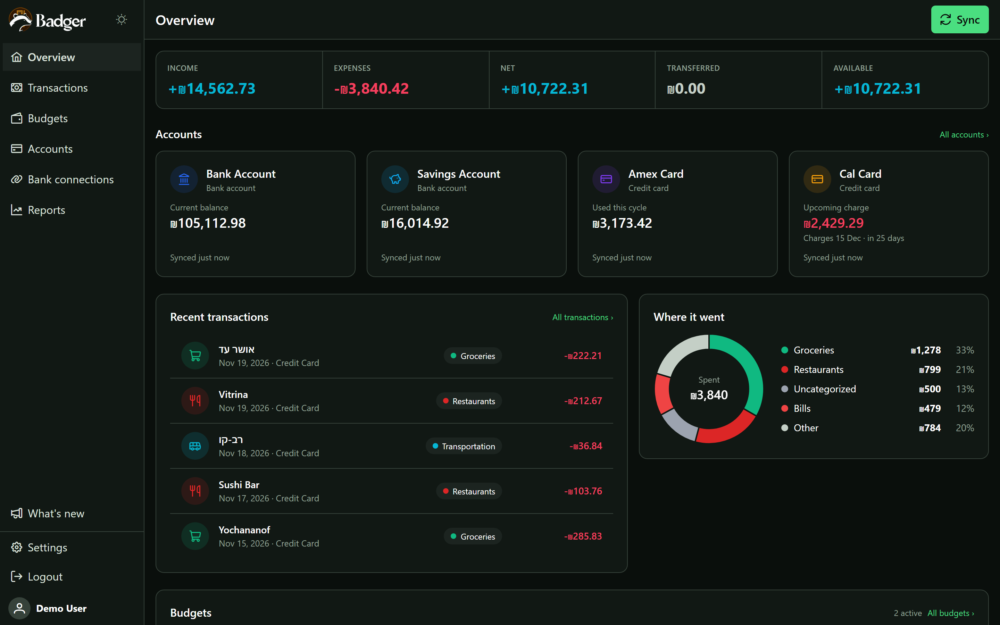
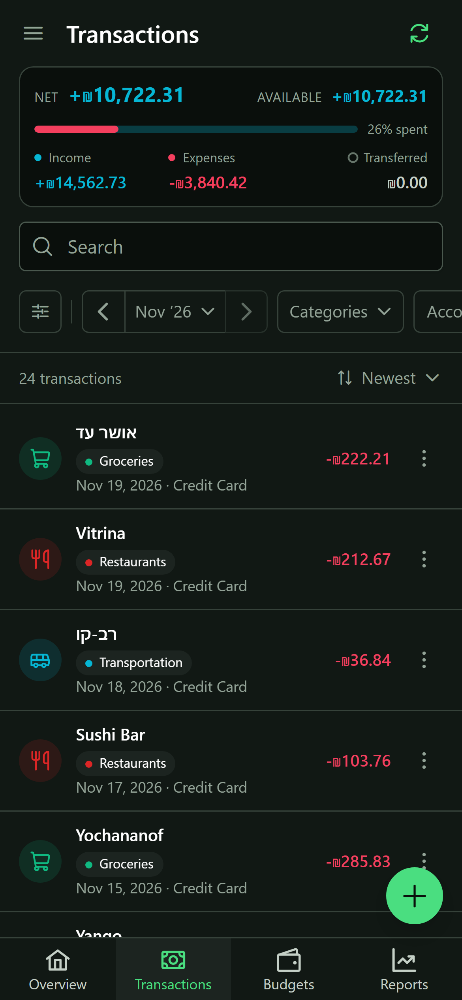

<p align="center">
    <picture>
        <source media="(prefers-color-scheme: dark)" srcset="apps/web/public/brand/logo-dark.svg">
        
    </picture>
</p>

# Badger

All your accounts, cards and expenses in one place. Badger is a friendly finance tracking app you run yourself, so your money is easy to see and your data stays on your own server.

- **Accounts and transactions**, with categories and rules that sort things for you
- **Budgets and reports** that show how the month is really going
- **Bank sync** that pulls in transactions from Israeli banks and credit cards automatically
- **Works on your phone** as an installable PWA, with notifications
- **Ask your AI assistant** about your spending: connect Claude, ChatGPT or another AI app (read-only)
- **Your data stays yours.** No ads, no tracking, no third-party cloud

<p align="center">
    
    &nbsp;
    
</p>

## Get it running

All you need is Docker. Then:

```bash
curl -O https://raw.githubusercontent.com/shai-raz/badger-budget/main/docker-compose.yml
docker compose up -d
```

Open <http://localhost:8080> and create your account. That's it: no config needed.

The first account you create is the admin, and sign-ups close after it. You can [open them again](docs/self-hosting.md#registration) to invite family or a partner.

Your database is backed up every night to `./backups`.

## Upgrading

```bash
docker compose pull
docker compose up -d
```

Database migrations run on their own. See what's new in the [changelog](CHANGELOG.md).

## Going further

The [self-hosting guide](docs/self-hosting.md) covers everything else, when you need it:

- [Settings and secrets](docs/self-hosting.md#configuration)
- [Optional features](docs/self-hosting.md#optional-features) like multiple currencies and receipt attachments
- [HTTPS and reverse proxies](docs/self-hosting.md#https-and-reverse-proxy)
- [Backups and restore](docs/self-hosting.md#backups-and-restore)
- [Upgrading in more depth](docs/self-hosting.md#upgrading), including one-click upgrades from inside the app

Hosting on Coolify or Dokploy? There are ready-made guides in [`deploy/`](deploy/). Got another platform working? A guide for it is very welcome.

## Contributing

Ideas, bug reports and pull requests are all welcome. To run it locally:

```bash
docker compose -f docker-compose.dev.yml up -d   # Postgres on port 5433
pnpm install
pnpm dev                                          # web on :3001, API on :3000
```

[AGENTS.md](AGENTS.md) has the commands and conventions.

## License

Badger Budget is free and open source under the [AGPL-3.0](LICENSE).
